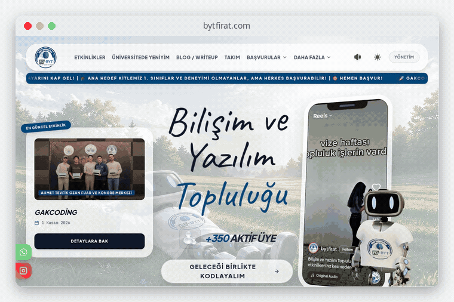
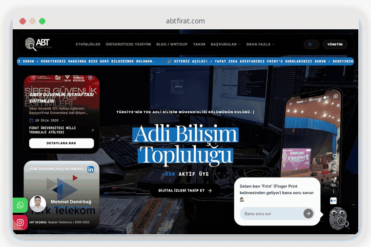

# Club Infrastructure (Kulüp Altyapısı)

[Türkçe](README.md) · **English**

A ready-made web stack for university student clubs: a public website, a content management panel (CMS) and a
desktop tool for club admins. Event registration, QR tickets and door check-in, team competitions with live
judging, verifiable certificates, membership and core-team applications, a blog, FAQ and a "new at university"
guide come built in.

Each club deploys and runs this repo **on its own accounts, by itself**. Its data stays in its own database.
The site is intentionally plain and neutral: the flows work, and each club restyles it as it likes.

> The user interface, content and code comments are in **Turkish**. File, folder and setting names (such as
> `kulup.config.json`, `kisaAd`, `etkinlikler`) are Turkish too; their meaning is explained below.

https://github.com/user-attachments/assets/d0f2b649-9995-4920-b7f5-1e1ac282c646

**Demo video (2.5 min, [download](docs/demo/kalkan-demo.mp4)):** clone the repo, fill in `kulup.config.json`,
admin panel, website, link-in-bio (`/link`) page, QR ticket, scanning at the door, and the worker app.

> The sample club in this repo, **Kalkan Cyber Security Club** at "Örnek Teknik Üniversitesi", is **fictional**.
> The logo, event/blog images and member portraits were generated with AI; the people are made up. For your own
> club, replace `kulup.config.json`, the logos (`site/public/logo.png`, `cms/public/logo.png`, `worker/assets/`)
> and the content. To load the same sample data locally, run `cd cms && npm run seed:demo` with the CMS stopped
> (it wipes the local SQLite database and refuses to run against Postgres).

## Clubs using this stack

| [Information & Software Club · bytfirat.com](https://www.bytfirat.com) | [Digital Forensics Club · abtfirat.com](https://www.abtfirat.com) |
|---|---|
| [](https://www.bytfirat.com) | [](https://www.abtfirat.com) |

**Want to use it for your club but not sure how to set it up?** Open this repo in an AI coding assistant
(Claude Code, Codex, etc.) and ask it to "set up this stack for my club"; it can follow the steps below and get
you running quickly. If you still get stuck, email **efecamn200@gmail.com** and I'll help.

## Parts

| Part | Folder | Technology | Runs on |
|---|---|---|---|
| Website | `site/` | Next.js 16 (App Router), React 19, Tailwind 4, next-intl | Vercel (project 1) |
| CMS | `cms/` | Payload CMS 3.90 (Next.js 15), Postgres | Vercel (project 2), panel at `/admin` |
| Worker | `worker/` | Electron + Vite + React, whatsapp-web.js | Admins' computers (optional) |
| Club identity | `kulup.config.json` | — | Single source; `scripts/kulup-ayarla.mjs` copies it into each project |

External services (the free tier of each is enough): **Supabase** (Postgres), **Cloudflare R2** (files) and
**Turnstile** (bot protection for forms), **Resend** (email), and an optional **Telegram** bot (notifications,
nightly backup, end-of-day report).

---

## 1. Describe your club: `kulup.config.json`

The club's name, university, addresses, emails, social accounts, colors, certificate code prefix and campus
location live in this file. Edit it, then run:

```bash
node scripts/kulup-ayarla.mjs      # validates and copies into site/src, cms/src, worker/shared
```

The copies (`*/kulup.json`) are not edited by hand and are committed (Vercel builds each project from its own
folder). `node scripts/kulup-ayarla.mjs --kontrol` checks that the copies are up to date.

| Field | Where it shows up |
|---|---|
| `kisaAd` (short name), `tamAd` (full name), `universite`, `sehir` (city), `slogan`, `aciklama` (description) | Headings, footer, SEO, emails, panel title, worker |
| `adresler.site/cms/cdn` | Links, CORS, security headers (CSP), allowed image origins. An environment variable overrides it if set |
| `eposta.*` | Sender name/address (must be on a domain verified in Resend), contact address |
| `sosyal.*` | Social accounts; empty ones are hidden |
| `tema.anaRenk` | The site's main color (`--kulup-ana`): buttons, heading blocks, accents; light/dark shades are derived from it |
| `tema.ikinciRenk` | Bottom strip of the link-preview image |
| `sertifika.onEk` | Certificate codes: `<PREFIX>-2026-KTLM-…` (2-8 uppercase letters/digits). **Do not change it after issuing certificates** |
| `kampus` | Map on the contact page |

Images (keep the file names, replace the contents). `bash scripts/gorsel-uret.sh` (needs ImageMagick) generates
placeholder versions from the name and color in the config:

- `site/public/logo.png`: logo (navbar, footer, ticket)
- `site/public/og/varsayilan.jpg`: link-preview image (1200×630, under 300 KB)
- `site/src/app/icon.png`, `apple-icon.png`, `site/public/favicon.ico`, `site/public/pwa/*`: icons
- `site/public/mail/*`: email header/footer images
- `cms/public/logo.png`: admin panel logo
- `worker/assets/icon.png`, `worker/src/assets/*`: worker icon and login images

UI: colors and fonts are in `site/src/app/globals.css` (design tokens at the top) and `site/src/app/fonts.ts`;
shared building blocks (`Dugme` button, `Kart` card, `SayfaBasligi` page header, `Alan` field…) are in
`site/src/components/kit`.

---

## 2. Run locally

Requirements: Node.js 22+, Docker (only for generating the schema).
- The site and worker use **npm** (`package-lock.json`).
- The CMS uses **pnpm 10** (`pnpm-lock.yaml`; Vercel uses it too).

```bash
# CMS: http://localhost:3001/admin (local SQLite: cms/data/dev.db)
cd cms
cp .env.example .env            # fill in at least PAYLOAD_SECRET
npx pnpm@10 install
npx pnpm@10 dev
npx pnpm@10 seed:local          # optional sample data (or: npm run seed:demo for the Kalkan demo)

# Site: http://localhost:3000 (not 127.0.0.1)
cd site
cp .env.example .env.local      # NEXT_PUBLIC_CMS_URL=http://127.0.0.1:3001
npm ci
npm run dev
```

Locally, `INTERNAL_API_KEY` and `REVALIDATE_SECRET` must have the same value in both projects. Use the Turnstile
test keys for forms (listed in `site/.env.example`).

For the worker, see `worker/README.md`.

---

## 3. Production setup (once)

Order matters; each step uses the output of the previous one.

1. **Repo:** create your own repo from this template on GitHub (it can be private). Fill in
   `kulup.config.json`, run `node scripts/kulup-ayarla.mjs`, commit.
2. **Database (Supabase):** create a new project. Then:
   - In the **SQL Editor**, run the whole `cms/sql/000_kurulum.sql` file once. This creates every table.
   - Under **Project Settings → Database**, copy the *Transaction pooler* connection string. That is `DATABASE_URL`.
3. **Files (Cloudflare R2):**
   - Create a bucket (e.g. `kulup-medya`).
   - Create an API token scoped to this bucket only. It gives `R2_ACCESS_KEY_ID` and `R2_SECRET_ACCESS_KEY`.
   - The S3 endpoint is `R2_ENDPOINT`: `https://<account-id>.r2.cloudflarestorage.com`.
   - Attach a custom domain to the bucket (e.g. `cdn.myclub.com`). That becomes `NEXT_PUBLIC_CDN_URL` and `adresler.cdn`.
4. **Bot protection (Cloudflare Turnstile):** create a widget for your site's domain. Get the site key and the secret key.
5. **Email (Resend):** verify your domain and create an API key. The sender address (`eposta.gonderen`) must be on that domain.
6. **Secrets:** run `openssl rand -hex 32` for each of:
   - `PAYLOAD_SECRET`
   - `ENCRYPTION_KEY`
   - `INTERNAL_API_KEY` (same in both projects)
   - `REVALIDATE_SECRET` (same in both projects)
   - `CRON_SECRET`
   - `ANALYTICS_SALT_SECRET`
   - `OBS_HASH_SECRET`
   - `PARTICIPANT_CODE_SECRET`
   - `PARTICIPANT_SESSION_SECRET`
7. **CMS (Vercel project 1):**
   - Import the GitHub repo. **Root Directory** must be `cms`. Vercel uses pnpm when it sees `pnpm-lock.yaml`.
   - Add the environment variables from `cms/.env.example`. Do not set `NODE_ENV` yourself.
   - Attach a domain (e.g. `panel.myclub.com`).
   - Crons are defined in `cms/vercel.json`: nightly backup and end-of-day report. Each requires `CRON_SECRET`.
8. **Site (Vercel project 2):**
   - Import the same repo with **Root Directory** `site`.
   - Add the environment variables from `site/.env.example`. `NEXT_PUBLIC_*` variables are baked into the build;
     redeploy after changing them.
   - Attach a domain.
9. **First admin:**
   - Open `https://<panel>/admin` and create the first account.
   - Two-factor authentication (TOTP) is mandatory; set it up with the authenticator app on your phone.
   - Then fill in **Site Settings**: member count, "About us" text, social media, privacy/KVKK texts.
10. **Telegram (optional):**
    - Create a bot and add it to a group. Set `TELEGRAM_BOT_TOKEN` and `TELEGRAM_CHAT_ID`.
    - For the commands (`/ping`, `/yedekle`), register the webhook with `secret_token=$TELEGRAM_WEBHOOK_SECRET`.

Check: does an event page open on the site, does the site update within seconds when you change a record in the
CMS (`REVALIDATE_SECRET`), does the contact form reach a test address.

---

## Rules (read this first)

These rules protect the live system and members' data.

1. **Pushing to `main` = deploying to production.** Both Vercel projects rebuild on every push to `main`. To save
   the free quota, collect changes on a branch and push them together.
2. **Never run a Payload schema "push" or `payload migrate` against the live database.** A push drops tables
   Payload does not know about (`analytics_events`, `obs.*`). The schema is managed with the files in `cms/sql/`
   (see [Database schema](#database-schema)). When connecting to a local Postgres, push is only enabled with
   `PAYLOAD_PUSH=1`; never against the live address.
3. **No deleting, moving or `sync` in the media bucket.** Only add files under new names; when a file changes,
   give it a new name (the CDN caches the old one).
4. **Secrets never enter the repo.** `.env*` files (except `.env.example`) are git-ignored. Keys live in Vercel.
5. **No test messages to real people.** In testing, email/WhatsApp only go to allow-lists:
   `PARTICIPANT_MAIL_ALLOWLIST`, `STAGING_MAIL_ALLOWLIST`, `BYT_WORKER_WA_ALLOWLIST`, `BYT_WORKER_MAIL_ALLOWLIST`.
   (Names prefixed with `BYT_` are an internal convention; don't rename them.)
6. **Privacy (KVKK, Turkey's data protection law):** members' names, phone numbers and emails live only in the
   CMS; don't put exported lists in the repo. Analytics are cookieless, raw IPs are not stored, and old
   monitoring records are deleted by the end-of-day cron.
7. **Next.js 16** may differ from the Next.js in AI training data (e.g. `middleware` is now "proxy"). Before
   writing site code, read the relevant guide in `site/node_modules/next/dist/docs/` (`site/AGENTS.md`).

---

## Architecture

```
Visitor ──► Site (Vercel) ──► CMS REST API (Vercel) ──► Postgres (Supabase: public + obs schemas)
               │  ISR + tagged cache         │  Payload collections
               │  /api/cms/*  (allow-listed  ├─► R2 ──► CDN domain
               │              proxy)         ├─► Resend (email)
               │  /api/takim/* (team mode)   ├─► Telegram (notifications, nightly backup, daily report)
               │                             └─► Vercel cron: backup, report
Admin ─► CMS panel (/admin, 2FA required)
Admin ─► Worker (desktop) ─► CMS API (own session) + WhatsApp Web + local PDF/email
```

- **Reading data:** the site calls the CMS REST API on the server (`site/src/lib/api.ts`). If the CMS is
  unreachable, `site/src/lib/fallbackData.ts` is used (generated with `node scripts/export-fallback.mjs`).
- **Cache revalidation:** when a record changes in the CMS, `withSiteRevalidate` calls the site's
  `POST /api/revalidate`. Fallback ISR: events 1 hour, other content 1 day. If you add a new content collection,
  its slug must be added in **three places**: `cms/src/lib/siteRevalidate.ts`, `site/src/lib/revalidate.ts` and
  the fetch `tags` in `site/src/lib/api.ts`.
- **Forms:** protected by Turnstile (single-use token, per-form rate limit). The site forwards only allowed
  fields to the CMS with `INTERNAL_API_KEY` (`site/src/lib/cmsProxy.ts`). In the CMS, `duplicateGuard` rejects a
  repeat application from the same person with 409.
- **Team mode:** if an event has `teamMode`, participants sign in with an email code (`/katilimci`), create or
  join a team; the jury scores at `/katilimci/juri/<eventId>`, and the hall screen is `/sahne/<eventId>`.
  CMS endpoints: `cms/src/endpoints/teams.ts`, `juryLive.ts`.
- **Mirrored files:** `site/src/lib/teams/design.ts` ↔ `cms/src/lib/teams/teamDesign.ts`,
  `site/src/lib/jury/score.ts` ↔ `cms/src/lib/teams/score.ts`, `site/src/lib/teams/contact.ts` ↔
  `cms/src/lib/teams/contact.ts`. Change both together; CMS tests check that they match.
- **Certificates:** the worker generates them, uploads to R2 and writes to the CMS `certificates` collection; the
  site verifies them at `/sertifika/<code>`.
- **Door (check-in):** `/admin/kapi` in the CMS panel and the Kapı (door) screen in the worker; the ticket QR is scanned.
- **Analytics and monitoring:** our own analytics (`/api/analytics/collect`, `/admin/istatistikler` in the
  panel); raw data is aggregated without storing personal data.

---

## Tests and checks

| Project | Command |
|---|---|
| Club identity | `node scripts/kulup-ayarla.mjs --kontrol` |
| Site | `cd site && npx tsx --test tests/*.test.ts` |
| Site | `npx tsc --noEmit -p . && npm run lint` |
| Site | `npx next build` (production build before pushing) |
| CMS | `cd cms && npx pnpm@10 exec vitest run` (`tests/int/api.int.spec.ts` needs a real database) |
| Worker | `cd worker && npm run typecheck && npm test` |

Minimum check before pushing: type check, tests, and opening the changed pages in a production build, in light
and dark themes, at desktop and phone widths.

---

## Deploying

1. Changes accumulate on a branch; every commit should build on its own.
2. If a change needs a new table/column, the SQL file is applied to production **first** (see below).
3. If a new environment variable is needed, add it to Vercel **first**.
4. Merge and push to `main`; once both projects are `READY`, check the changed pages on the live site.
5. To roll back, "Promote" the previous deployment in Vercel, or `git revert` + push.

---

## Database schema

- `cms/sql/000_kurulum.sql`: the full schema applied once to an empty database (Payload tables + analytics + monitoring).
- Later changes: `cms/sql/001_<topic>.sql`, `002_…` (`BEGIN; … COMMIT;`, additions only, no `DROP`).

When you add a collection or field:

1. Change the code.
2. Run `cd cms && bash scripts/sema-uret.sh`. It starts a temporary Postgres in Docker and dumps the current
   Payload schema from the code into `cms/sql/.uretilen-sema.sql`.
3. Compare this dump with `000_kurulum.sql` (and later files). Copy **only the additive** statements from the
   difference into a new file: `CREATE TABLE/TYPE/INDEX`, `ALTER TABLE … ADD …`.
4. Apply it to the test database first, then production. **Then** deploy the CMS code.

---

## Folder guide

```
kulup.config.json            the club's identity (single source)
scripts/                     kulup-ayarla.mjs (config copy), export-fallback.mjs
site/src/app/[locale]/       pages (etkinlikler=events, blog, basvuru=applications, katilimci=participant,
                             sertifika=certificate, ticket, takim=team, link, …)
site/src/app/api/            CMS proxy, team proxy, revalidate, OG image
site/src/components/         home, events, teams, jury, layout, ui
site/src/lib/                kulup.ts (config), api.ts (CMS reads), cmsProxy, revalidate, seo, teams, jury
cms/src/collections/         Payload collections (Events, EventRegistrations, Teams, Certificates, …)
cms/src/globals/             SiteSettings, LegalDocs, UniversityGuideSettings
cms/src/endpoints/           custom endpoints: teams, juryLive, gateCheckin
cms/src/lib/                 kulup.ts (config), resend, telegram, backup, siteRevalidate, duplicateGuard, obs, analytics
cms/sql/                     database schema (000_kurulum.sql + later changes)
cms/seed-gorseller/          images for the Kalkan demo seed
worker/                      desktop tool (has its own README)
```

---

## Common tasks

- **Changing the home page:** `site/src/app/[locale]/page.tsx` orders the sections. Sections live in
  `site/src/components/home/`; content comes from the CMS.
- **Menu:** `navLinks` in `site/src/components/layout/Navbar.tsx`.
- **New content collection:** write the collection → generate and apply a schema file → add the slug to the three
  cache lists (Architecture > Cache revalidation) → add a fetch function in the site's `lib/api.ts`.
- **Changing an image:** rename the file or add `?v=<hash>`; the browser cache lasts 1 hour.
- **Test environment (staging):** a separate Supabase project + `BYT_STAGING=1` in a Vercel Preview environment
  (CMS, email lock) and `NEXT_PUBLIC_BYT_STAGING=1` (site, hidden from search engines).
